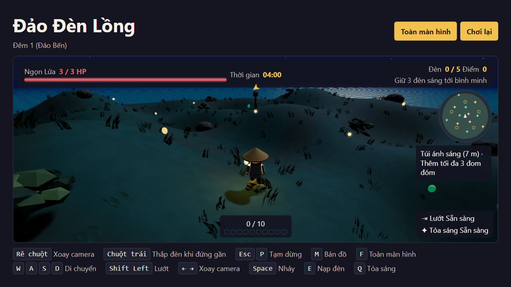

# Đảo Đèn Lồng

[Video demo MP4](docs/demo/demo.mp4)

**v1.0.0.** Điều khiển Mây qua Đảo Bến, Cầu Tre và Đảo Tháp Chuông. Đèn hao dầu và có thể tắt trong đêm. Đến bình minh, Mây phải còn Ngọn Lửa và giữ sáng ít nhất 3/5, 4/6 hoặc 5/7 đèn tương ứng.



## Chạy game

Cần Node.js 20 trở lên và Chrome, Edge hoặc Chromium. WebGL 2 dùng cho đồ họa 3D. Mở terminal trong thư mục repo và chạy:

```sh
npm ci
npm start
```

Mở http://127.0.0.1:8080 và bấm **Bắt đầu**. Bản web dùng cùng mã mô phỏng với headless và chạy trên Windows, macOS và Linux.

Bản web ưu tiên Three.js/WebGL 2 để dựng địa hình, nhân vật, nước và bóng đổ 3D. Trình duyệt thiếu WebGL 2 dùng trình vẽ Canvas dự phòng.

| Phím | Hành động |
|---|---|
| Rê chuột trong màn chơi | Xoay camera quanh Mây |
| Bấm chuột trái trong màn chơi | Nạp đom đóm vào đèn gần nhất và thắp đèn khi đủ |
| Esc hoặc P | Tạm dừng và mở menu |
| M | Mở hoặc đóng bản đồ lớn trong lúc chơi |
| F | Bật hoặc tắt toàn màn hình |
| W, A, S, D | Di chuyển theo camera |
| Shift | Lướt theo hướng di chuyển. Khi đứng yên, lướt theo hướng camera |
| ←, → | Xoay camera |
| Space | Nhảy |
| E | Nạp đom đóm vào đèn gần nhất, cần 5 con cho mỗi đèn |
| Q | Tỏa sáng, tốn 2 đom đóm và làm choáng Bóng Mực gần Mây |

Thắp lần đầu cần **10 đom đóm**, thắp lại cần **5**. Bấm E hoặc chuột trái khi đứng gần đèn sáng để châm dầu. Dưới 30 dầu, đèn mất vùng an toàn và có thể bị Bóng Mực hút dầu. Mỗi lần thắp thành công tăng sức chứa thêm 2, tối đa 20.

Nạp hoặc châm dầu cho 5 điểm mỗi đom đóm. Thắp lần đầu được 100, thắp lại được 40. Tỏa Sáng trúng Bóng Mực được 5 điểm, hoặc 15 nếu con đó đang hút dầu. Khi thắng, mỗi đèn còn sáng cho 50 điểm cộng phần nguyên của dầu còn lại, và mỗi Ngọn Lửa cho 50 điểm.

## Kiểm thử

```sh
npm test
node headless.mjs --seed 42 --night 3 --ticks 120 --out output.jsonl
```

Headless v1.3 nhận `--night 1`, `2` hoặc `3`, hỗ trợ `--scenario <file.json>`, `--inputs <file.json>` và `--snapshot-every <int>` (mặc định 10). Xem [quyết định Phase 3](docs/adr-phase-3.md) và [changelog](CHANGELOG.md).

## Benchmark, soak và bảng điểm

```sh
node scripts/bench.mjs --seed 42 --duration 30 --out bench.json
node --expose-gc --jitless --max-semi-space-size=1 scripts/soak.mjs --seed 7 --nights 10 --out soak.json
npm start -- --export-leaderboard out.json
```

Benchmark mở Chrome/Chromium ở 1280×720. Đặt biến môi trường `BENCH_CHROME` nếu trình chạy không tìm đúng trình duyệt. Dùng `requestAnimationFrame` theo nhịp vẽ của trình duyệt nên `vsync_off` là `false`. Trình duyệt không cung cấp RSS đỉnh của cảnh qua API web, nên `peak_mem_mb` là `null`. Báo cáo local ở [bench.json](bench.json) và [soak.json](soak.json). Bộ đo soak lấy RSS sau GC ở hai mốc và dùng cùng một tiến trình Node trong cả mười Đêm.

Bảng điểm lưu tại `.local/leaderboard.json` trong thư mục chạy game. Sau khi thua hoặc thắng Đêm 3, nhập tên 3–12 ký tự chữ Latin, số hoặc dấu gạch dưới. Mở **Bảng xếp hạng** từ menu chính. **Esc/P → Cài đặt** có đổi phím, bảng màu dễ phân biệt, giảm chuyển động và tăng cỡ chữ.

Đóng gói bằng `npm run pack:release`. Thư mục `dist/dao-den-long-v1.0.0` đã có thư viện trình duyệt. Chạy `node server.mjs` bên trong gói. Xem [bằng chứng Phase 4](docs/phase-4.md) và [retro](docs/retro.md).

## Sáng tạo của tôi

Mặt biển có sóng, phản chiếu ánh trăng và bọt ở chân vách đá. Bụi cỏ, đá và bầu trời sao trang trí cả ba đêm. Đá ở bản web chặn Mây khi đi bộ hoặc lướt. Bản đồ lớn mở bằng M trong khi trận vẫn tiếp tục. Lá hồi sức hồi 1 Ngọn Lửa và Túi ánh sáng bổ sung tối đa 3 đom đóm ở bản web Đêm 1. Các vật phẩm và đá trang trí tách khỏi mô phỏng headless.

---

# Tài liệu đề bài

> **Cá nhân** (1 người / 1 MSSV) · Áp dụng SDLC cùng AI để xây một **game 3D** qua **4 phase**, từ yêu cầu ban đầu tới bản phát hành.
> **Lab board + trợ giảng:** **[Đảo Đèn Lồng Lab](https://claude.ai/artifact/Q1RYyv1dxjUczzCbd2ZnoW)**

---

## Tài liệu của lab

| File | Nội dung |
|---|---|
| [GUIDE.md](GUIDE.md) | Hướng dẫn làm lab: vòng làm việc mỗi phase, harness, kiểm chứng, token |
| [CHECKPOINTS.md](CHECKPOINTS.md) | Các mốc tự kiểm tra từ chuẩn bị đến nộp bài |
| [SUBMISSION.md](SUBMISSION.md) | Đặt tên repo, hạn nộp, tag, Release, video, checklist |
| [RULES.md](RULES.md) | Quy định: AI, trung thực về bằng chứng, bản quyền, bảo mật |
| [RUBRIC.md](RUBRIC.md) | Thang điểm chi tiết |

## Lab board

Yêu cầu dự án được phát hành tại **[Đảo Đèn Lồng Lab](https://claude.ai/artifact/Q1RYyv1dxjUczzCbd2ZnoW)**. Mỗi phase là một tab (tab chưa phát hành bị khóa), mỗi tab có trợ giảng AI riêng chỉ trả lời trong phạm vi phase đó. Trợ giảng cần đăng nhập claude.ai và dùng lượt Claude của bạn.

## Dự án

**Đảo Đèn Lồng**: game 3D góc nhìn thứ ba. Mây, người giữ đèn nhỏ tuổi, gom đom đóm để thắp lại các Đèn Lồng Lớn và né Bóng Mực trong sương đen.

- Không ràng buộc công nghệ; chạy được trên macOS hoặc Linux.
- Tuân theo **Test Contract** (chế độ headless) để được chấm tự động và so sánh với nhau.

| Phase | Bạn nhận | Nộp |
|---|---|---|
| 1 | **PRD-0** (mô tả tổng quát) + Test Contract | tag `phase-1` |
| 2 | **Ticket-02**, phát hành khi Phase 1 kết thúc | tag `phase-2` |
| 3 | **Ticket-03**, phát hành khi Phase 2 kết thúc | tag `phase-3` |
| 4 | **Ticket-04**, phát hành khi Phase 3 kết thúc | tag `phase-4` + Release `v1.0.0` |

Yêu cầu sẽ được bổ sung và có thể thay đổi giữa các phase, giống dự án thật.

### Lịch 4 giờ

Bài lab kéo dài **4 giờ**. Phase 1 và 2 khoảng **1 giờ**, Phase 3 khoảng **30 phút**, Phase 4 khoảng **1 giờ 30 phút**. Mỗi phase phát hành đúng mốc giờ. Phase mới xuất hiện trên lab board khi tới mốc.

| Mốc | Sự kiện | Hạn tag |
|---|---|---|
| 0h | Phát hành **Phase 1** (PRD-0), gồm cả phần chuẩn bị | `phase-1` trước mốc 1h |
| 1h | Phát hành **Phase 2** | `phase-2` trước mốc 2h |
| 2h | Phát hành **Phase 3** | `phase-3` trước mốc 2h30 |
| 2h30 | Phát hành **Phase 4** | `phase-4`, Release `v1.0.0` và video trước mốc 4h |
| 4h | Hết giờ lab, chốt bài | |

Hết giờ mỗi phase thì tag và chuyển sang phase tiếp theo, dù phase chưa hoàn hảo. Chỗ chưa xong ghi trung thực trong bằng chứng.

---

## Gợi ý SDLC (cách làm là của bạn)

Mỗi phase là một vòng nhỏ. Công cụ, thứ tự, định dạng tài liệu đều tự do; đây chỉ là gợi ý:

1. **Requirements:** biến yêu cầu thành tiêu chí nghiệm thu kiểm chứng được. Chỗ mơ hồ thì tự giả định và ghi lại.
2. **Plan:** nghĩ cách kiểm chứng **trước** khi để agent viết code.
3. **Build:** để agent viết, bạn điều phối và review.
4. **Verify:** chạy thật, kiểm tra hành vi thật. *Không có bằng chứng thì chưa xong*: "agent bảo chạy rồi" không phải bằng chứng.
5. **Evaluate:** cái gì đạt, AI sai ở đâu, harness (AGENTS.md, skill, hook) cần chỉnh gì.
6. **Release:** gắn tag.

## Ba điều cần nhớ

> Bạn được **tự do sáng tạo thêm** quanh phần lõi (nhân vật, cơ chế nhỏ, câu chuyện, hiệu ứng, âm thanh…). Sáng tạo gọn và không phá yêu cầu được tính điểm trong hạng mục F của [RUBRIC](RUBRIC.md); ghi mục "Sáng tạo của tôi" trong README của bạn.

- **Game tốt là game đúng yêu cầu của khách hàng**, không phải game phức tạp hay đẹp nhất. Làm đúng và chứng minh được là đúng trước, trau chuốt sau.
- **Cân nhắc kỹ quota token của bạn.** Đốt nhiều token không làm bài tốt hơn. Ngữ cảnh gọn, kế hoạch rõ, kiểm chứng sớm thường vừa rẻ vừa đúng hơn chạy agent liên tục.
- **Kiểm chứng là phần quan trọng nhất.** Bằng chứng (test, output headless, ảnh, số đo) đáng giá hơn lời mô tả.

---

## Bàn giao cuối cùng

Một **repo GitHub cá nhân, public**, gồm:

1. **Toàn bộ mã nguồn** của game qua 4 phase, tag `phase-1` … `phase-4`, Release `v1.0.0`.
2. **Video demo `.mp4` dưới 5 phút** (đính kèm Release `v1.0.0` hoặc `docs/demo/demo.mp4`, link ở đầu README): chơi thử và cho thấy bằng chứng game chạy đúng.
3. **Bằng chứng kiểm chứng** của từng phase (định dạng tự chọn).
4. **Harness AI đã dùng** (AGENTS.md / CLAUDE.md, skills, hooks, plugins…), giữ nguyên trong repo và lịch sử git.
5. **Ghi chép ngắn:** spec/giả định mỗi phase, nhật ký dùng AI (gồm token/chi phí ước tính), retro.

Không commit API key, token hay `.env`. Gửi link repo theo hướng dẫn của Coach.

## Đánh giá (100 điểm)

| Hạng mục | Điểm |
|---|---|
| Test tự động ẩn (headless, gồm kiểm tra lại phase trước) | 30 |
| Kiểm chứng & bằng chứng của bạn | 20 |
| Quy trình SDLC & harness AI | 15 |
| Evaluation & retro (gồm cách bạn dùng token) | 10 |
| Hiệu năng & ổn định | 10 |
| Chất lượng sản phẩm (đúng yêu cầu, chơi được) | 10 |
| Video demo | 5 |

## Quy định

- Dùng AI thoải mái; không sao chép repo của người khác.
- Bằng chứng phải thật: test luôn đạt hay output sửa tay là vi phạm.
- Nhân vật, bối cảnh là bản gốc của lab; asset bên ngoài chỉ dùng loại CC0/CC-BY/MIT hoặc tự tạo, ghi nguồn trong `CREDITS.md`.
